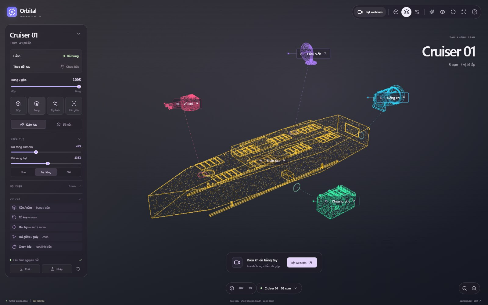
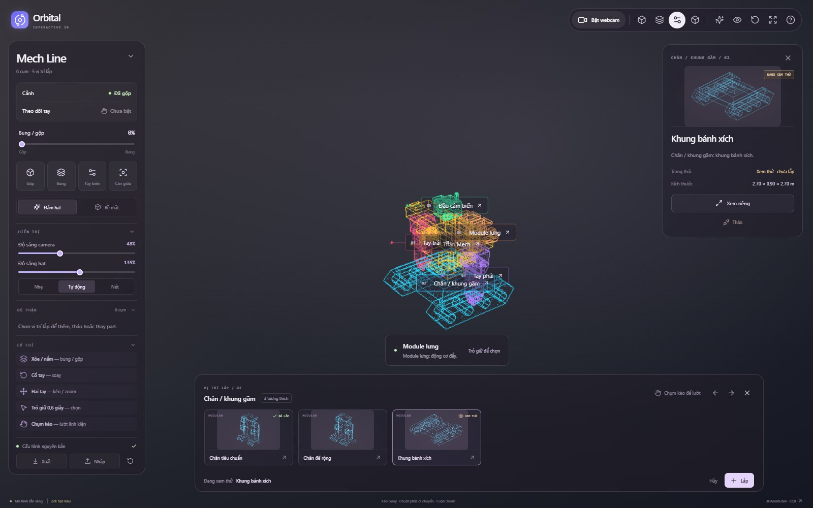
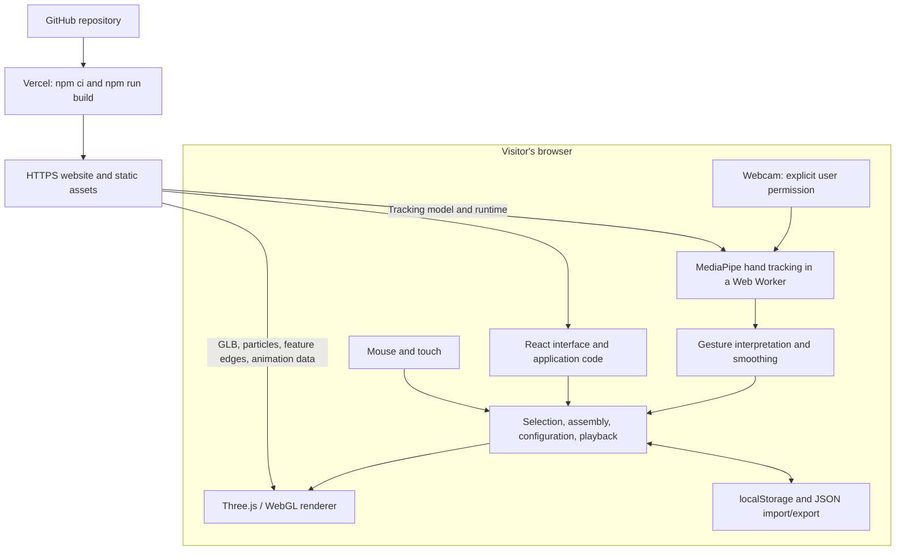

# Orbital — Interactive 3D Assembly Workshop

Explore, take apart, and customize modular 3D models using a mouse, touch, or webcam hand gestures. Orbital renders colored surface particles with straight feature edges over an optional live camera background.

Built with React, TypeScript, Three.js, and MediaPipe. Inspired by TakeApart-style exploration and attachment-based customization. The application UI is currently in Vietnamese.

## Demo



*Cruiser 01: exploded assembly with a different color for each part.*



*Mech Line: preview a compatible replacement before installing it. Both screenshots show the actual application with the webcam disabled.*

## Features

- **Explore assemblies:** smoothly explode/reassemble models, point at parts for information, and isolate a part for independent rotation and zoom.
- **Customize compatible slots:** preview, install, remove, or cancel a replacement. Reassembly reflects the current configuration, including empty slots.
- **Use hand controls:** wrist rotation, two-hand pan/zoom, open-hand/fist assembly controls, and dwell selection with a progress ring.
- **Play animations:** select a clip, pause/resume, loop, play once, or restore the original pose. Replacement parts stay attached to their moving parent.
- **Adjust the display:** particles or solid surfaces, camera brightness, particle brightness, labels, and quality presets.
- **Keep configurations:** independent saves for each model in browser storage, plus JSON import/export.

## Model library

| Model | Replaceable slots | Motion |
| --- | --- | --- |
| Cruiser 01 | Engine, weapon, sensor, utility bay | No source animation |
| City Car / Ô tô City | Four independently replaceable wheels; three options per wheel | Wheel rotation added by the application |
| Mech Line | Chassis, left arm, right arm, head, back module | No source animation |
| Carbine | Stock, magazine, optic, muzzle, underbarrel, side rail | Six original clips |
| Pistol | Magazine, optic, muzzle, underbarrel | Five original clips |

Slots only offer reviewed compatible parts. The Carbine side rail has one accessory that can be installed or removed. Fixed groups can be inspected but cannot be replaced. Models separate into the groups provided by the source assets; internal geometry authored as one piece is not automatically split into mechanical components.

See [MODEL-ASSET-AUDIT.md](MODEL-ASSET-AUDIT.md) for sources, compatibility evidence, animation details, and asset preparation.

## Pipeline



Vercel serves the application. Each visitor's browser performs hand tracking and renders the scene on their own device. No backend, database, API key, or GPU server is required. Webcam frames and hand landmarks are not uploaded by the application.

The MediaPipe runtime and pretrained hand model are served from the same origin. Tracking runs in a worker where supported, prefers available hardware acceleration, and falls back to CPU or the compatibility path when needed. Particles and edges are prepared ahead of time rather than generated on page load.

## Run locally

Install **Node.js 24.x** and use a recent Chrome or Edge with WebGL enabled.

```sh
npm ci
npm run dev
```

Open the localhost URL printed by Vite, normally `http://127.0.0.1:5173`. Click **Bật webcam** to enable hand tracking and allow camera access. Camera access requires localhost or HTTPS. Mouse controls work without a webcam.

`npm ci` runs `postinstall` to copy the pinned MediaPipe runtime from `node_modules` into `public/hand`. These generated runtime files are ignored by Git; the pretrained `hand_landmarker.task` model is included in the repository. Python is only needed if you choose to re-download source assets.

### Controls

| Action | Mouse / touch | Hand gesture |
| --- | --- | --- |
| Rotate | Left drag / one-finger drag | Rotate or tilt your wrist |
| Pan | Right drag / two-finger drag | Move two open hands together |
| Zoom | Scroll / pinch on the screen | Move two open hands apart or together |
| Select | Click a part, label, or control | Point and hold for about 0.6 seconds |
| Explode / assemble | **Bung / Gộp** or the slider | Open / close one hand |
| Browse replacement parts | Scroll, drag, or use arrow buttons | Pinch and drag across the catalog |

Use the model name at the bottom to open the five-model library. **Tùy biến** opens replacement parts; **Lắp** installs a preview and **Hủy** cancels it. **Xem riêng bộ phận** isolates the selected part. **Xuất / Nhập** exports or imports the active model's configuration.

## Development and validation

```sh
npm test                 # Unit tests
npm run test:e2e         # Browser interaction tests
npm run build           # TypeScript checks and production build
npm run preview         # Inspect the production build locally
```

Browser tests use an installed Chrome/Edge on Windows when available. Otherwise install Chromium with `npx playwright install chromium`. Set `CHROME_PATH` to use another browser executable. Tests use simulated camera input; sensitivity and lighting should also be checked with a real webcam.

| Path | Purpose |
| --- | --- |
| `src/App.tsx`, `src/styles.css` | Camera overlay UI, configuration and playback state |
| `src/scene.ts`, `src/particles.ts` | Asset loading, picking, rendering, assembly and animation |
| `src/hands.ts`, `src/gestures.ts`, `public/hand/worker.js` | Hand tracking, gesture interpretation and smoothing |
| `src/catalog.ts`, `src/models.ts`, `src/modular.generated.json` | Model library, slots and compatibility rules |
| `public/models`, `public/particles`, `public/animations` | Deployable assets and precomputed geometry data |
| `scripts/` | Optional asset download/preparation and runtime setup |
| `tests/` | Unit tests and Playwright browser tests |

## Publish on GitHub

Create an **empty** repository on GitHub, for example `orbital-workshop`. Do not initialize it with another README, license, or `.gitignore`.

From this project directory, run the following, replacing `YOUR_USERNAME` with your GitHub username:

```sh
git init -b main
git add .
git status
git commit -m "Initial release of Orbital 3D workshop"
git remote add origin https://github.com/YOUR_USERNAME/orbital-workshop.git
git push -u origin main
```

Complete GitHub authentication when prompted. If Git asks for your identity, configure `git config user.name "Your Name"` and `git config user.email "YOUR_GITHUB_EMAIL"` in this repository, then retry the commit.

The `.gitignore` excludes dependencies, build output, local tools, generated MediaPipe runtime, test output, and environment files. Keep the prepared 3D assets, particles, animations, source metadata, and pretrained hand model in Git: Vercel uses these files directly.

## Deploy to Vercel

1. Sign in to [Vercel](https://vercel.com/new) and import the GitHub repository.
2. Use the repository root as **Root Directory**, then check these settings:

   | Setting | Value |
   | --- | --- |
   | Framework | Vite |
   | Node.js | 24.x |
   | Install command | `npm ci` |
   | Build command | `npm run build` |
   | Output directory | `dist` |
   | Environment variables | None |

3. Click **Deploy**. Install, framework, build and output settings are also declared in `vercel.json`.
4. Copy the production domain shown under **Domains**, such as `https://your-project.vercel.app`. Test it in a private browser window and on another device. If it asks visitors to sign in to Vercel, check the project's Deployment Protection settings and use a public production domain.
5. Allow camera access on the deployed HTTPS website, then test model switching, replacement parts, animations, and hand controls.

Your computer can be turned off after deployment. Vercel hosts the files, and each visitor's device runs the application. Future pushes to the connected production branch trigger updates. Vercel Hobby is intended for personal, non-commercial use and has usage limits.

Official guides: [push an existing project to GitHub](https://docs.github.com/en/migrations/importing-source-code/using-the-command-line-to-import-source-code/adding-locally-hosted-code-to-github), [Vite on Vercel](https://vercel.com/docs/frameworks/frontend/vite), [deployment access](https://vercel.com/docs/deployment-protection), [Hobby plan](https://vercel.com/docs/plans/hobby).

## Scope and limitations

- Hand tracking and WebGL performance depend on the visitor's hardware, browser, lighting, and camera. Lower the quality preset on slower devices; a dedicated GPU is not required.
- Gestures provide screen-relative interaction, not calibrated physical AR placement or exact real-world depth.
- Assembly uses declared sockets and compatibility rules, without physics or collision simulation.
- Configurations are local to each browser and website origin. Localhost saves do not automatically transfer to the deployed domain; use JSON export/import to move them.
- The application does not upload camera data. Google Fonts is used to load interface fonts.

## Asset credits

The 3D library uses CC0 assets from [3DAssets.dev](https://3dassets.dev/) and [Kenney Car Kit](https://kenney.nl/assets/car-kit). Source links and geometry adaptations are documented in [MODEL-ASSET-AUDIT.md](MODEL-ASSET-AUDIT.md). Original Kenney license text is kept in [public/licenses/kenney-car-kit.txt](public/licenses/kenney-car-kit.txt).

MediaPipe runtime/model provenance is documented in [public/hand/LICENSE.md](public/hand/LICENSE.md). Third-party assets and dependencies retain their respective licenses.
