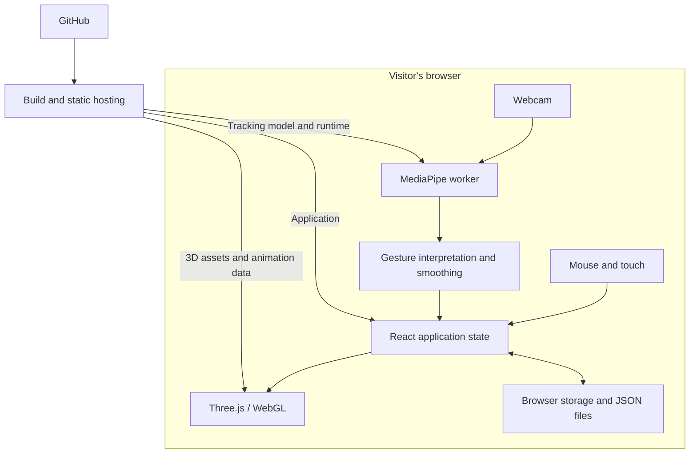

# Orbital - Interactive 3D Assembly Workshop

Explore, take apart, and customize modular 3D models with mouse, touch, or webcam hand gestures. Built with React, TypeScript, Three.js, and MediaPipe, with colored particles, straight feature edges, and an optional live camera background.

**[Try the live demo](https://orbital-3d-workshop.vercel.app/)** - Enable the camera in the app to use hand controls.

Documentation is in English; the application UI is currently in Vietnamese.

## Demo


Screenshots show the actual application with the webcam disabled.

## Features

- Smooth exploded views, part information, and isolated rotation/zoom.
- Compatible replacement parts with preview, install, cancel, and removal.
- Wrist rotation, two-hand pan/zoom, and point-and-hold selection.
- Selectable animations with pause, looping, and pose reset.
- Adjustable quality and brightness; Auto adapts 3D resolution to GPU tracking load. Per-model browser saves and JSON import/export.

| Model | Replaceable parts | Animation |
| --- | --- | --- |
| Cruiser 01 | Engine, weapon, sensor, utility bay | None |
| City Car | Four independent wheels, three options each | Procedural wheel rotation |
| Mech Line | Chassis, arms, head, back module | None |
| Carbine | Stock, magazine, optic, muzzle, underbarrel, side rail | Six source clips |
| Pistol | Magazine, optic, muzzle, underbarrel | Five source clips |

Models separate into authored assembly groups. Fixed groups remain inspectable; the Carbine side rail supports adding/removing one accessory. See the [asset audit](MODEL-ASSET-AUDIT.md) for compatibility rules and preparation details.

## Pipeline



Tracking and rendering run on each visitor's device. No backend, API key, or GPU server is required. Camera frames and hand landmarks are not uploaded. The runtime is served from the same origin; particles and edges are prepared ahead of time.

## Quick start

Requires **Node.js 24.x** and a recent Chrome or Edge with WebGL enabled.

```sh
npm ci
npm run dev
```

Open the localhost URL printed by Vite. Use the camera button and allow webcam access to enable hand tracking. Camera access requires localhost or HTTPS; mouse controls work without it. Installation automatically prepares the MediaPipe runtime.

| Action | Mouse / touch | Hand gesture |
| --- | --- | --- |
| Rotate | Left drag / one-finger drag | Rotate or tilt your wrist |
| Pan | Right drag / two-finger drag | Move two open hands together |
| Zoom | Scroll / screen pinch | Move two open hands apart/together |
| Select | Click a part or label | Point and hold for about 0.6 seconds |
| Explode / assemble | Buttons or slider | Open / close one hand |
| Browse parts | Scroll, drag, or arrow buttons | Pinch and drag the catalog |

Use the model selector at the bottom to switch models. Select a slot to preview compatible parts, then install or cancel. Configurations are saved per browser and website origin; use JSON export/import to transfer them. Performance depends on the device and lighting. Assembly uses declared sockets without physics or collision simulation.

## Validation

```sh
npm test
npm run test:e2e
npm run build
npm run preview
```

Browser tests use local Chrome/Edge on Windows, or Chromium installed with `npx playwright install chromium`. Set `CHROME_PATH` for another executable. Some tests use simulated camera input; check gestures with a real webcam as well.

For performance comparisons, append `?debug=1` to the local or deployed URL, enable the webcam, and use **Copy report**. Diagnostics include timings, frame rates and camera settings, without images or landmarks.

## Deploy your own copy

Fork this repository or push a copy to your GitHub account, then:

1. Sign in to [Vercel](https://vercel.com/new) and import the repository.
2. Use the repository root, **Vite**, and **Node.js 24.x**. Install: `npm ci`; build: `npm run build`; output: `dist`. No environment variables are needed. Settings are included in `vercel.json`.
3. Deploy and share the production domain. Test it in a private window and allow webcam access. If it asks for Vercel login, check Deployment Protection and the domain's public access.

Keep the prepared models, particles, animations, and hand-tracking model in Git. Dependencies, local tools, generated runtime files, and build/test output are ignored. Future pushes to the connected production branch update the website; your computer can be off. Vercel Hobby is for personal, non-commercial use within its usage limits.

## Credits

3D models use CC0 assets from [3DAssets.dev](https://3dassets.dev/) and [Kenney](https://kenney.nl/assets/car-kit). Sources and geometry adaptations are listed in [MODEL-ASSET-AUDIT.md](MODEL-ASSET-AUDIT.md), with the original [Kenney license](public/licenses/kenney-car-kit.txt). See [MediaPipe provenance](public/hand/LICENSE.md) for the tracking runtime and model. Third-party assets and dependencies retain their respective licenses.
